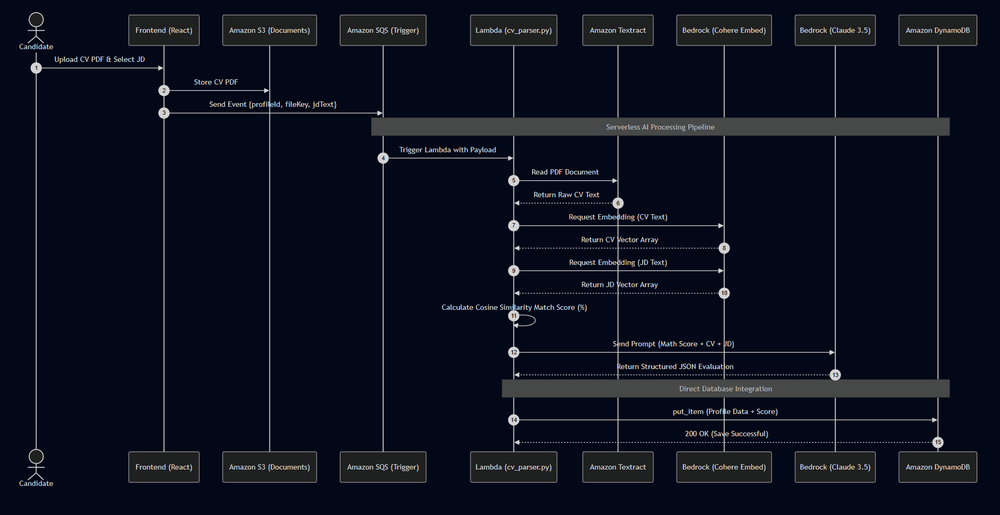
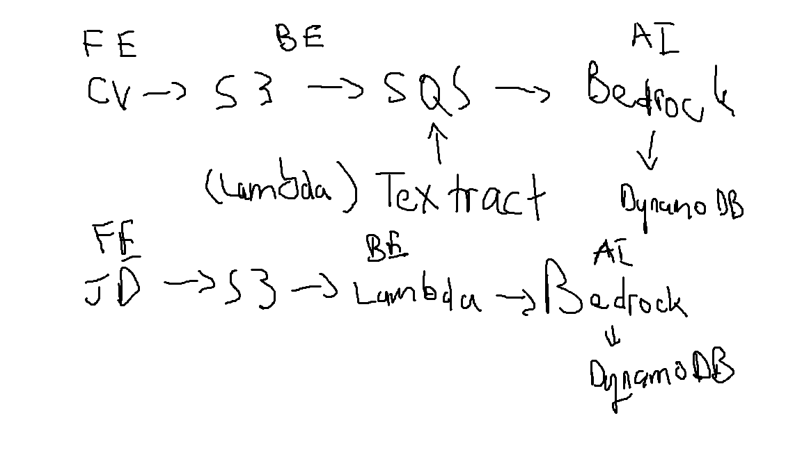
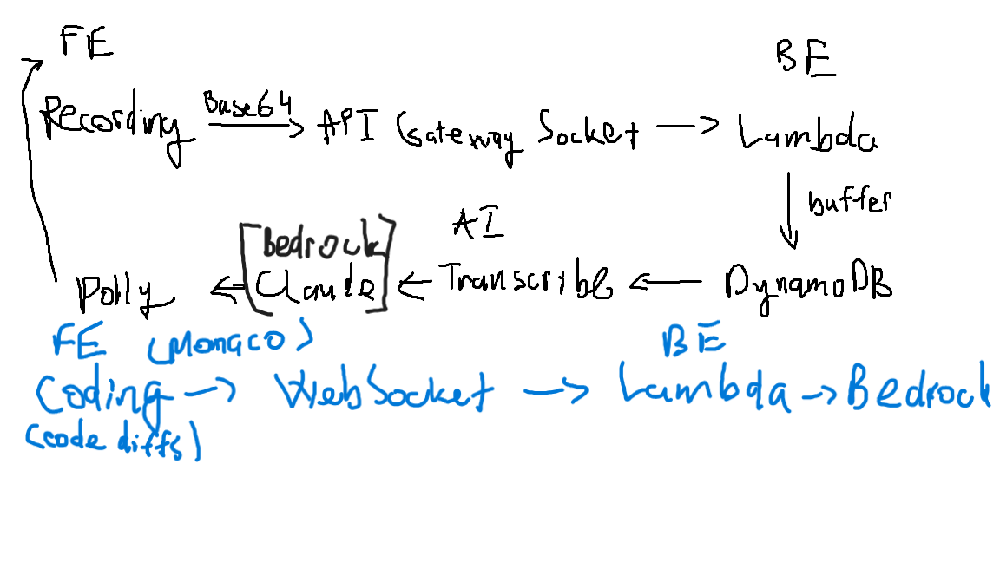
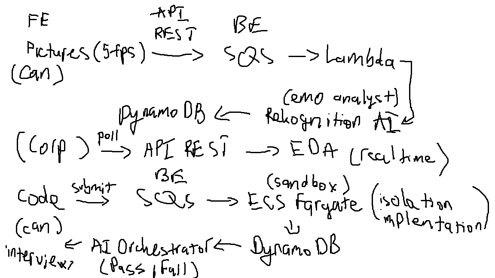
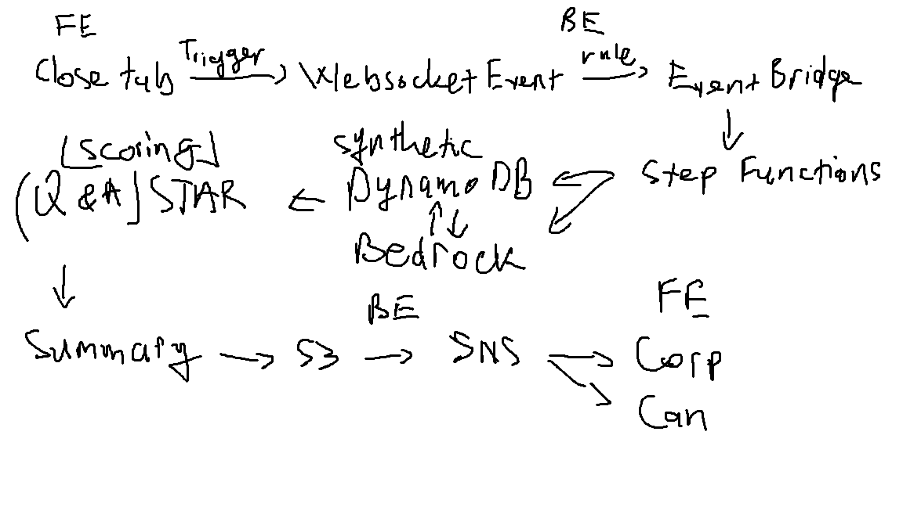

# SmartHire AI Core

AI microservices for **SmartHire**, an AI-driven recruitment platform on AWS: **CV ↔ job-description matching** and an **automated technical interview** with real-time voice, emotion tracking and STAR-based evaluation.

This repository is my development history for the AI layer of SmartHire, built during the **AWS First Cloud AI Journey** internship bootcamp. The team's final integrated product (React front end, .NET API, Terraform / SAM infrastructure) lives in [SmartHire_AI](https://github.com/justeg4n/SmartHire_AI).

## 1. Smart matching pipeline (`lambda/`)

Event-driven pipeline that turns uploaded CVs and job descriptions into embeddings and ranked matches.

| Lambda | Responsibility |
|--------|----------------|
| `ingestion_trigger` | Validates the S3 upload, records it in DynamoDB and starts the Step Functions workflow |
| `vector_ops` / `text_processor` | Extract text (Textract), mask PII with spaCy NER (blind screening), analyse the profile with Bedrock Claude and create Cohere embeddings |
| `vector_persister` | Persists profiles and embeddings to RDS PostgreSQL + pgvector (VPC-bound) |
| `job_suggestion_engine` | For a candidate: ANN search over jobs, then hybrid bi-encoder / cross-encoder re-ranking |
| `candidate_ranking_engine` | For a job: ranks applicants with the same hybrid scoring |
| `appsync_notifier` | Pushes results to the web app through AWS AppSync GraphQL subscriptions |
| `cognito_pre_signup`, `cognito_post_confirmation` | Cognito triggers for federated (Google) sign-up and user provisioning |

Design notes: [`architecture-smart-matching.md`](architecture-smart-matching.md).

## 2. AI interview pipeline (`production_lambdas/`)

| Stage | Lambda | AWS services |
|-------|--------|--------------|
| Real-time interview | `ai_orchestrator_lambda.py` — one interview turn: context-aware question generation from the CV, live code and history, then speech synthesis | Bedrock (Claude), Polly |
| Vision analytics | `emotion_tracker_lambda.py` — per-frame emotion and head-pose analysis | Rekognition |
| Evaluation | `star_evaluator_lambda.py` — grades every Q&A turn with the STAR method | Bedrock |
| Evaluation | `emotion_aggregator_lambda.py` — aggregates per-frame emotion data | DynamoDB |
| Reporting | `report_generator_lambda.py` — final "Hire / No Hire" executive summary | Bedrock |

`local_tests_and_scripts/` contains the local prototypes of these stages (Bedrock tests, Polly TTS, interview simulator, data cleaning).



| Phase 1 | Phase 2 |
|:---:|:---:|
|  |  |
| **Phase 3** | **Phase 4** |
|  |  |

Full product blueprint (scope, sprints, team roles): [`SmartHire_Blueprint.md`](SmartHire_Blueprint.md) · Interview system diagram: [`interview_system_architecture.svg`](interview_system_architecture.svg).

## Repository structure

```
├── lambda/                     # smart matching pipeline (Python + Node.js Cognito triggers)
├── production_lambdas/         # AI interview pipeline
├── local_tests_and_scripts/    # local prototypes and test scripts
├── diagram/                    # architecture diagrams
├── architecture-smart-matching.md
├── SmartHire_Blueprint.md
└── interview_system_architecture.svg
```

## Configuration

All resource names, ARNs and endpoints are read from environment variables (for example `CV_BUCKET_NAME`, `STATE_MACHINE_ARN`, `RDS_PROXY_ENDPOINT`, `RDS_SECRET_ARN`, `APPSYNC_URL`); credentials come from the Lambda execution role. The CV / JD datasets used for testing are not included.

## Tech stack

AWS Lambda · Step Functions · S3 · SQS · DynamoDB · RDS PostgreSQL + pgvector · Amazon Bedrock (Claude, Cohere Embed) · Textract · Rekognition · Polly · AppSync · Cognito · spaCy · Python · Node.js
