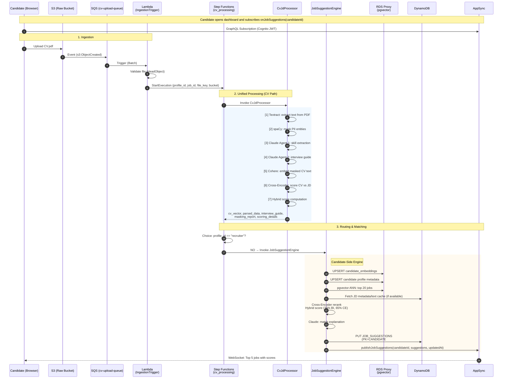
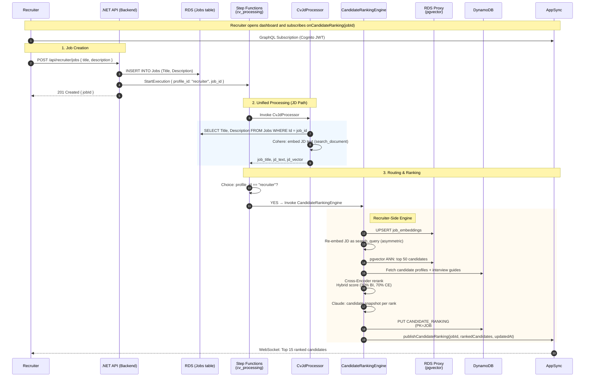
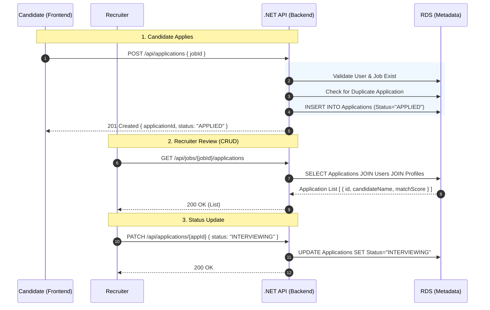
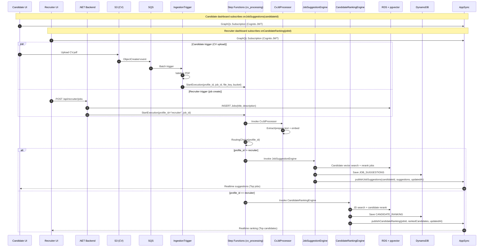
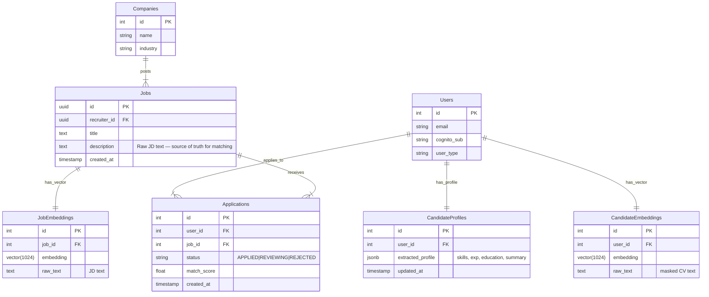

# SmartHire Matching System Architecture (v3.0 — Unified Pipeline)

## Overview

This document details the **Smart JD Matching System v3.0**, redesigned for simplicity and efficiency.

**Key Changes from v2.0:**

- **No JD PDF Upload**: Job Description text is read directly from RDS (`Jobs.Description`) instead of uploading PDF to S3.
- **Merged Processing Lambda**: `text_processor` and `vector_ops` merged into a single `cv_jd_processor` Lambda.
- **Direct JD Trigger**: .NET backend calls Step Functions `StartExecution` directly for JD processing (bypasses S3/SQS/IngestionTrigger).
- **Simplified State Machine**: Step Functions reduced from 4 states to 3 (CvJdProcessor → RoutingChoice → Engine).
- **Reduced Latency**: One fewer Lambda cold start per execution (2 Lambdas merged into 1).
- **Real-Time Contract via AppSync**: Matching engines publish updates through AppSync GraphQL mutations, and frontend receives filtered subscriptions.

## Quick Explanation (Easy View)

If you remember only 4 things, remember these:

1. Candidate upload CV -> system parses CV -> computes top matching jobs -> pushes realtime to candidate UI.
2. Recruiter creates job -> system embeds JD -> ranks top candidates -> pushes realtime to recruiter UI.
3. Step Functions always has 3 steps: `CvJdProcessor -> RoutingChoice -> Engine`.
4. AppSync is only the realtime delivery layer (publish from Lambda, subscribe from frontend), not the compute layer.

### Real-Time Contract (Current)

- Mutation: `publishJobSuggestions(candidateId, suggestions, updatedAt)`
- Mutation: `publishCandidateRanking(jobId, rankedCandidates, updatedAt)`
- Subscription: `onJobSuggestions(candidateId)`
- Subscription: `onCandidateRanking(jobId)`

Important: schema field is `updatedAt` (not `timestamp`).

---

## 1. System Workflows (Sequence Diagrams)

### A. Candidate Flow (CV Upload → Job Suggestions)



### B. Recruiter Flow (Job Create → Ranked Candidates)



### C. Application Management Flow (.NET Core CRUD)



### D. Master End-to-End Flow (Single View)



---

## 2. Detailed Data Flows (I/O Schemas)

### A. CvJdProcessor Lambda — CV Path

**Trigger:** Step Functions (from IngestionTrigger via S3 → SQS)

**Input:**

```json
{
  "profile_id": "candidate-uuid",
  "job_id": "job-uuid | null",
  "file_key": "candidates/{candidateId}/cv.pdf",
  "bucket": "smarthire-raw-assets",
  "jd_text": "Job description text (optional, from DynamoDB cache)",
  "job_title": "Senior Backend Engineer (optional)",
  "required_skills": ["AWS", "Python"],
  "jd_vector": [0.12, 0.45, "...1024 floats (optional, cached)"]
}
```

**Processing Steps:**

| Step | Operation      | Service               | Description                                             |
| ---- | -------------- | --------------------- | ------------------------------------------------------- |
| 1    | Textract       | AWS Textract          | Extract raw text from S3 PDF (async)                    |
| 2    | PII Masking    | spaCy NER             | Replace PERSON, ORG, GPE, LOC, NORP with neutral tokens |
| 3    | Claude Agent 1 | Bedrock (Claude)      | Extract skills, seniority, experience, strengths/gaps   |
| 4    | Claude Agent 2 | Bedrock (Claude)      | Generate 3 targeted interview questions                 |
| 5    | Bi-Encoder     | Bedrock (Cohere)      | Embed masked CV text as `search_document` (1024-dim)    |
| 6    | Cross-Encoder  | sentence-transformers | Score CV chunks against JD text (if JD provided)        |
| 7    | Hybrid Score   | Local computation     | Blend BI (35%) + CE (65%) scores                        |

**Output:**

```json
{
  "profile_id": "candidate-uuid",
  "file_key": "candidates/{candidateId}/cv.pdf",
  "bucket": "smarthire-raw-assets",
  "job_id": "job-uuid | null",
  "job_title": "Senior Backend Engineer",
  "masked_cv_text": "Masked CV text (PII removed, max 50K chars)",
  "cv_vector": [0.12, 0.45, "...1024 floats"],
  "parsed_data": {
    "seniority_estimate": "Senior",
    "frontend_skills": ["React", "TypeScript"],
    "backend_skills": ["Python", "AWS Lambda"],
    "devops_skills": ["Docker", "Terraform"],
    "soft_skills": ["Leadership"],
    "years_experience": 5,
    "matching_score": 82.5,
    "strengths": "Strong backend expertise...",
    "gaps": "Limited frontend experience..."
  },
  "scoring_details": {
    "bi_encoder_score": 78.5,
    "cross_encoder_score": 85.2,
    "hybrid_score": 82.5,
    "bi_encoder_weight": 0.35,
    "cross_encoder_weight": 0.65,
    "method": "hybrid_bi_cross_encoder"
  },
  "interview_guide": [
    {
      "question": "Explain event-driven architecture...",
      "skill_targeted": "System Design",
      "rationale": "Tests understanding of async patterns"
    }
  ],
  "masking_report": {
    "blind_screening": "applied",
    "total_entities_masked": 12,
    "by_label": { "PERSON": 3, "ORG": 5, "GPE": 4 }
  },
  "jd_text": "Job description text",
  "jd_vector": [0.12, 0.45, "...1024 floats | null"]
}
```

### B. CvJdProcessor Lambda — JD Path

**Trigger:** Step Functions (from .NET backend `StartExecution`)

**Input:**

```json
{
  "profile_id": "recruiter",
  "job_id": "job-uuid"
}
```

**Processing Steps:**

| Step | Operation  | Service          | Description                                             |
| ---- | ---------- | ---------------- | ------------------------------------------------------- |
| 1    | Read JD    | RDS (PostgreSQL) | `SELECT Title, Description FROM Jobs WHERE Id = job_id` |
| 2    | Bi-Encoder | Bedrock (Cohere) | Embed JD text as `search_document` (1024-dim)           |

**Output:**

```json
{
  "profile_id": "recruiter",
  "job_id": "job-uuid",
  "job_title": "Senior Backend Engineer",
  "jd_text": "Raw JD description from RDS Jobs table",
  "jd_vector": [0.12, 0.45, "...1024 floats"],
  "masked_cv_text": "Same as jd_text (backward compat for CandidateRankingEngine)"
}
```

### C. JobSuggestionEngine (Candidate Flow)

**Input:** Output from CvJdProcessor CV path (see above)

**Output (DynamoDB write + AppSync publish):**

```json
{
  "PK": "CANDIDATE#{profile_id}",
  "SK": "JOB_SUGGESTIONS",
  "type": "JOB_SUGGESTIONS",
  "candidateId": "candidate-uuid",
  "suggestions": [
    {
      "jobId": "job-uuid",
      "jobTitle": "Senior Backend Engineer",
      "biScore": 78.5,
      "crossScore": 82.1,
      "finalScore": 80.8,
      "matchExplanation": "Strong fit due to..."
    }
  ],
  "suggestionCount": 5,
  "updatedAt": "2026-03-30T10:30:00Z",
  "expiresAt": 1746000000
}
```

**AppSync publish payload:**

```json
{
  "candidateId": "candidate-uuid",
  "suggestions": "[ ...AWSJSON... ]",
  "updatedAt": "2026-03-30T10:30:00Z"
}
```

### D. CandidateRankingEngine (Recruiter Flow)

**Input:** Output from CvJdProcessor JD path (see above)

**Output (DynamoDB write + AppSync publish):**

```json
{
  "PK": "JOB#{job_id}",
  "SK": "CANDIDATE_RANKING",
  "type": "CANDIDATE_RANKING",
  "jobId": "job-uuid",
  "rankedCandidates": [
    {
      "candidateId": "candidate-uuid",
      "rank": 1,
      "seniority": "Senior",
      "yearsExperience": 5,
      "biEncoderScore": 85.2,
      "crossEncoderScore": 88.7,
      "finalScore": 87.3,
      "candidateSnapshot": "The candidate brings 5 years of backend experience...",
      "topSkills": ["AWS", "Python", "Lambda"],
      "interviewGuide": [],
      "applicationStatus": "POOL"
    }
  ],
  "candidateCount": 15,
  "updatedAt": "2026-03-30T10:30:00Z"
}
```

**AppSync publish payload:**

```json
{
  "jobId": "job-uuid",
  "rankedCandidates": "[ ...AWSJSON... ]",
  "updatedAt": "2026-03-30T10:30:00Z"
}
```

---

## 3. Data Models & Entity Relationships (ERD)

### A. Unified Database Schema



### B. Data Storage Strategy

#### 1. Raw Assets (Amazon S3)

- **Bucket**: `smarthire-raw-assets`
- **Paths**: `candidates/{userId}/cv.pdf`
- **Purpose**: Immutable backup and audit trail for CV PDFs.
- **Note**: JD PDFs are no longer uploaded to S3. JD text is stored in RDS `Jobs.Description`.

#### 2. Relational & Vector Data (Amazon RDS PostgreSQL)

Serves as the **Source of Truth** for business entities and semantic search.

- **Business Tables**: `Users`, `Jobs`, `Applications`, `Companies`.
- **AI Tables**: `CandidateProfiles` (AI-extracted profile data).
- **Pgvector**: `CandidateEmbeddings`, `JobEmbeddings` (1024-dim Cohere vectors).
- **JD Source**: `Jobs.Description` column is read directly by `CvJdProcessor` Lambda.

#### 3. Hot Store / Cache (Amazon DynamoDB)

- **Table**: `ApplicationTracking` (Single Table Design)
- **Purpose**: High-frequency read/write operations for real-time UI updates (suggestions, rankings, parse results).

---

## 4. Optimized Component Architecture

### A. CvJdProcessor (Merged Processing Lambda)

Handles both CV and JD processing in a single Lambda with branching logic:

| Aspect              | CV Path (Candidate)                              | JD Path (Recruiter)                           |
| ------------------- | ------------------------------------------------ | --------------------------------------------- |
| **Trigger**         | Step Functions (via S3 → SQS → IngestionTrigger) | Step Functions (via .NET backend direct call) |
| **Text Source**     | Textract (S3 PDF)                                | RDS `Jobs.Description`                        |
| **PII Masking**     | Yes (spaCy NER)                                  | No                                            |
| **Claude Analysis** | Yes (Agent 1 + Agent 2)                          | No                                            |
| **Embedding**       | Yes (Cohere search_document)                     | Yes (Cohere search_document)                  |
| **Cross-Encoder**   | Yes (if JD provided)                             | No                                            |
| **Timeout**         | 300s                                             | 300s                                          |
| **Memory**          | 1024 MB                                          | 1024 MB                                       |
| **VPC**             | Yes (RDS access for JD read)                     | Yes (RDS access for JD read)                  |

### B. Engine Responsibilities (Autonomous)

**JobSuggestionEngine (Candidate Flow)**

- Receives: `profile_id`, `file_key`, `cv_vector`, `masked_cv_text`, `parsed_data`, `scoring_details`, `interview_guide`, `masking_report`
- Stores: CV embedding → RDS (`candidate_embeddings`)
- Stores: Candidate profile + embedding → RDS (`candidate_profiles_ai`, `candidate_embeddings`)
- Performs: pgvector ANN search for top 20 jobs
- Re-ranks: Cross-Encoder (top 5 jobs)
- Scores: Hybrid (35% BI-Encoder, 65% Cross-Encoder)
- Generates: Match explanation per job (Claude)
- Persists: Top 5 suggestions → DynamoDB (`SK=JOB_SUGGESTIONS`)

**CandidateRankingEngine (Recruiter Flow)**

- Receives: `job_id`, `jd_vector`, `jd_text`, `job_title`, `masked_cv_text`
- Stores: JD embedding → RDS (`job_embeddings`)
- Reuses: JD text as `search_query` embedding input for asymmetric retrieval
- Re-embeds: JD as `search_query` (asymmetric search)
- Performs: pgvector ANN search for top 50 candidates
- Enriches: Fetch candidate profiles + interview guides from DynamoDB
- Re-ranks: Cross-Encoder (top 15 candidates)
- Scores: Hybrid (30% BI-Encoder, 70% Cross-Encoder)
- Generates: Candidate snapshot per rank (Claude)
- Persists: Top 15 ranked candidates → DynamoDB (`SK=CANDIDATE_RANKING`)

### C. Orchestration: Step Functions (Unified Pipeline)

**State Machine: `cv_processing`**

```json
{
  "Comment": "SmartHire CV/JD processing orchestration: unified processor -> route to matching engine",
  "StartAt": "CvJdProcessor",
  "States": {
    "CvJdProcessor": {
      "Type": "Task",
      "Resource": "arn:aws:states:::lambda:invoke",
      "Parameters": {
        "FunctionName": "${cv_jd_processor_arn}",
        "Payload.$": "$"
      },
      "OutputPath": "$.Payload",
      "Retry": [
        {
          "ErrorEquals": [
            "Lambda.ServiceException",
            "Lambda.AWSLambdaException",
            "Lambda.SdkClientException",
            "States.TaskFailed"
          ],
          "IntervalSeconds": 2,
          "MaxAttempts": 3,
          "BackoffRate": 2
        }
      ],
      "Next": "RoutingChoice"
    },
    "RoutingChoice": {
      "Type": "Choice",
      "Choices": [
        {
          "Variable": "$.profile_id",
          "StringEquals": "recruiter",
          "Next": "CandidateRanking"
        }
      ],
      "Default": "JobSuggestion"
    },
    "JobSuggestion": {
      "Type": "Task",
      "Resource": "arn:aws:states:::lambda:invoke",
      "Parameters": {
        "FunctionName": "${job_suggestion_engine_arn}",
        "Payload.$": "$"
      },
      "OutputPath": "$.Payload",
      "Retry": [
        {
          "ErrorEquals": [
            "Lambda.ServiceException",
            "Lambda.AWSLambdaException",
            "Lambda.SdkClientException",
            "States.TaskFailed"
          ],
          "IntervalSeconds": 3,
          "MaxAttempts": 3,
          "BackoffRate": 2
        }
      ],
      "End": true
    },
    "CandidateRanking": {
      "Type": "Task",
      "Resource": "arn:aws:states:::lambda:invoke",
      "Parameters": {
        "FunctionName": "${candidate_ranking_engine_arn}",
        "Payload.$": "$"
      },
      "OutputPath": "$.Payload",
      "Retry": [
        {
          "ErrorEquals": [
            "Lambda.ServiceException",
            "Lambda.AWSLambdaException",
            "Lambda.SdkClientException",
            "States.TaskFailed"
          ],
          "IntervalSeconds": 3,
          "MaxAttempts": 3,
          "BackoffRate": 2
        }
      ],
      "End": true
    }
  }
}
```

**Key Points:**

- 3 states instead of 4 (merged TextProcessing + VectorOps into CvJdProcessor)
- Choice state differentiates CV (candidate) vs JD (recruiter) flow
- Engines write directly to RDS and DynamoDB (no separate persistence Lambda)
- CvJdProcessor reads JD text from RDS for recruiter flow (no S3/Textract)

---

## 5. RDS PostgreSQL Schema (Source of Truth)

**candidate_embeddings** (pgvector)

```sql
CREATE TABLE candidate_embeddings (
  user_id UUID PRIMARY KEY,
  embedding VECTOR(1024) NOT NULL,
  raw_text TEXT,
  updated_at TIMESTAMP DEFAULT NOW(),
  UNIQUE(user_id)
);
CREATE INDEX ON candidate_embeddings USING ivfflat (embedding vector_cosine_ops);
```

**job_embeddings** (pgvector)

```sql
CREATE TABLE job_embeddings (
  job_id UUID PRIMARY KEY,
  embedding VECTOR(1024) NOT NULL,
  raw_text TEXT,
  updated_at TIMESTAMP DEFAULT NOW(),
  UNIQUE(job_id)
);
CREATE INDEX ON job_embeddings USING ivfflat (embedding vector_cosine_ops);
```

**Jobs** (EF Core managed — JD text source)

```sql
CREATE TABLE "Jobs" (
  "Id" UUID PRIMARY KEY,
  "RecruiterId" UUID NOT NULL,
  "Title" TEXT,
  "Description" TEXT,
  "CreatedAt" TIMESTAMP WITH TIME ZONE,
  "JdFileUrl" TEXT
);
```

---

## 6. DynamoDB Schema (Hot Store, Single Table Design)

**Table: `ApplicationTracking`**

**Job Suggestions** (Candidate-side)

```json
{
  "PK": "CANDIDATE#{profile_id}",
  "SK": "JOB_SUGGESTIONS",
  "GSI1PK": "JOB_SUGGESTIONS",
  "GSI1SK": "2026-03-30T10:30:00Z",
  "type": "JOB_SUGGESTIONS",
  "candidateId": "...",
  "suggestions": [
    {
      "jobId": "...",
      "jobTitle": "...",
      "biScore": 78.5,
      "crossScore": 82.1,
      "finalScore": 80.8,
      "matchExplanation": "..."
    }
  ],
  "suggestionCount": 5,
  "updatedAt": "2026-03-30T10:30:00Z",
  "expiresAt": 1746000000
}
```

**Candidate Rankings** (Recruiter-side)

```json
{
  "PK": "JOB#{job_id}",
  "SK": "CANDIDATE_RANKING",
  "GSI1PK": "CANDIDATE_RANKING",
  "GSI1SK": "2026-03-30T10:30:00Z",
  "type": "CANDIDATE_RANKING",
  "jobId": "...",
  "rankedCandidates": [
    {
      "candidateId": "...",
      "rank": 1,
      "seniority": "Senior",
      "yearsExperience": 5,
      "biEncoderScore": 85.2,
      "crossEncoderScore": 88.7,
      "finalScore": 87.3,
      "candidateSnapshot": "...",
      "topSkills": ["AWS", "Python"],
      "interviewGuide": []
    }
  ],
  "candidateCount": 15,
  "updatedAt": "2026-03-30T10:30:00Z"
}
```

**Notes**

- JD text for suggestion cross-encoding is read directly from RDS `Jobs.Description`.
- Final recruiter/candidate artifacts are still persisted in DynamoDB (`CANDIDATE_RANKING`, `JOB_SUGGESTIONS`).

---

## 7. Infrastructure Components (IaC)

### A. Lambda Functions

| Lambda                     | Source                                 | Timeout | Memory  | VPC | Purpose                                              |
| -------------------------- | -------------------------------------- | ------- | ------- | --- | ---------------------------------------------------- |
| `ingestion-trigger`        | `iac/lambda/ingestion_trigger/`        | 30s     | 256 MB  | No  | Validate S3 CV uploads, start Step Functions         |
| `cv-jd-processor`          | `iac/lambda/cv_jd_processor/`          | 300s    | 1024 MB | Yes | Unified CV/JD processing (Textract/PII/Claude/Embed) |
| `job-suggestion-engine`    | `iac/lambda/job_suggestion_engine/`    | 90s     | 3008 MB | Yes | Find top matching jobs for a candidate               |
| `candidate-ranking-engine` | `iac/lambda/candidate_ranking_engine/` | 90s     | 3008 MB | Yes | Rank top matching candidates for a job               |

### B. Terraform Files

| Purpose                                                              | Path                                                                    |
| -------------------------------------------------------------------- | ----------------------------------------------------------------------- |
| Root orchestration (S3 notification, processing module)              | `iac/terraform/main.tf`                                                 |
| Pipeline Lambdas + Step Functions + DynamoDB + AppSync API/Resolvers | `iac/terraform/modules/processing/main.tf`                              |
| AppSync GraphQL schema                                               | `iac/terraform/modules/processing/appsync_schema.graphql`               |
| ASL template                                                         | `iac/terraform/modules/processing/state_machine_cv_processing.asl.json` |
| Processing outputs                                                   | `iac/terraform/modules/processing/outputs.tf`                           |
| SQS queues                                                           | `iac/terraform/modules/queue/main.tf`                                   |

### C. Removed Resources

- `text_processor` Lambda (merged into `cv_jd_processor`)
- `vector_ops` Lambda (merged into `cv_jd_processor`)
- S3 bucket notification for JD prefix (`jobs/*.pdf`)

---

## 8. Observability & Monitoring (AWS X-Ray)

### A. Tracing Scope

X-Ray instrumentation applies to the CV/JD processing flows:

1. **IngestionTrigger**: Trace file validation and Step Functions invocation.
2. **Step Functions Workflow**: Visualize orchestration path (CvJdProcessor → Engine).
3. **CvJdProcessor**: Trace Textract calls (CV), RDS reads (JD), embedding generation.
4. **Engines**: Trace pgvector queries, DynamoDB writes, Claude snapshot generation.

### B. Key Metrics to Monitor

- **End-to-End Latency**: Time from upload/job creation to ranking completion.
- **Error Rates**: Failures in Textract, Bedrock throttling, RDS timeouts.
- **Service Dependencies**: Lambda → RDS, Lambda → Bedrock, Lambda → DynamoDB.
- **Cold Starts**: Lambda initialization impact on processing throughput.

### C. Implementation Details

- **IAM Permissions**: `xray:PutTraceSegments` and `xray:PutTelemetryRecords` on Lambda execution roles.
- **Environment Variables**: `AWS_XRAY_CONTEXT_MISSING` set to `LOG_ERROR`.
- **Tracing Config**: Active tracing enabled on all Lambdas and Step Functions state machine.
